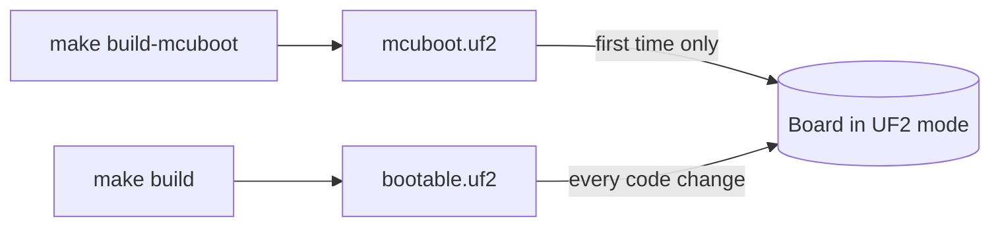

# Board List

The repo defines three PROVES Flight Controller boards under [`boards/bronco_space/`][boards]. All three use the RP2350A chip on its Cortex-M33 core. This page tells you which board you have and how to flash it. The [hardware details](#hardware-details) are at the end.

## Words used on this page

| Word | Meaning |
| ---- | ------- |
| MCUboot | A small bootloader. It runs first when the board starts. It checks that the application image is signed with the right key, then starts it. |
| UF2 | A file format for flashing over USB. In UF2 mode the board shows up as a USB drive. You flash it by copying a `.uf2` file onto that drive. |
| SWD | Serial Wire Debug. A wired debug connection to the chip. You can flash over SWD without UF2 mode. |
| Debug probe | A USB adapter that connects your computer to the board's SWD pins. |
| GDS | The F Prime Ground Data System. It runs on your computer, sends commands to the board, and shows what the board reports. |
| Slot | An area of the board's flash memory that holds one application image. |

## Which board do I have? { #which-board }

Look at the board. Its version (v5c, v5d, or v5e) is printed on the silkscreen.

Build for that version. The versions do not use the same LoRa radio driver, and v5e connects its GPIO expander to a different I2C bus. A build for the wrong version uses the wrong radio driver and the wrong expander bus. See [What differs between variants](#what-differs-between-variants).

| Board | `BOARD=` string | Vendor (`board.yml`) | LoRa driver | Flash (`.yaml`, KB) |
| ----- | --------------- | -------------------- | ----------- | ------------------- |
| v5c | `proves_flight_control_board_v5c/rp2350a/m33` | Bronco Space | `CONFIG_LORA_SX127X` | 4096 |
| v5d | `proves_flight_control_board_v5d/rp2350a/m33` | Bronco Space | `CONFIG_LORA_SX127X` | 16384 |
| v5e (default) | `proves_flight_control_board_v5e/rp2350a/m33` | The Spacecraft Company LLC | `CONFIG_LORA_SX126X` | 16384 |

v5e is the default because [`settings.ini`][settings-ini] sets `BOARD=proves_flight_control_board_v5e/rp2350a/m33`. To build for v5c or v5d, see [Specifying Board Configuration][specifying-board-configuration].

## Flashing

The Makefile makes these files at the repo root:

| File | Made by | Contents |
| ---- | ------- | -------- |
| `mcuboot.uf2` | `make build-mcuboot` | MCUboot bootloader, UF2 format |
| `mcuboot.elf` | `make build-mcuboot` | MCUboot bootloader, for SWD |
| `bootable.uf2` | `make build` | Signed application (`build-artifacts/zephyr.signed.bin`) as UF2, placed at `0x10100000` (`slot0_partition`) |
| `bootable.signed.hex` | `make build` | Signed application, for SWD |



!!! warning
    `make build-mcuboot` always builds MCUboot for v5e. [`tools/bin/build-with-proves`][build-with-proves] passes `-b proves_flight_control_board_v5e/rp2350a/m33` and does not read `settings.ini`. All three boards share one flash partition table (see [Flash partitions](#flash-partitions)), so MCUboot uses the same slot addresses on each board. The repo does not show that a v5e MCUboot is otherwise correct on v5c or v5d. Ask a maintainer to confirm before you rely on it.

### Flash over USB (UF2) { #flash-over-usb }

The commands below are for macOS and Linux.

#### Put the board into UF2 mode { #enter-uf2-mode }

Use one of these methods:

- **Buttons.** This works on every board, including a new board. Hold down BOOTSEL. Press and release RESET. Then release BOOTSEL.
- **GDS command.** This works only when the board already runs the F Prime application. Send `ReferenceDeployment.bootloaderTrigger.TRIGGER_BOOTLOADER` from the GDS. The [BootloaderTrigger][bootloader-trigger] component reboots the board into UF2 mode.

You should see a new USB drive named `RP2350`. Check that it is mounted:

```sh
# macOS
ls /Volumes/RP2350/

# Linux
lsblk -o NAME,LABEL,MOUNTPOINT
```

On Linux, the `MOUNTPOINT` column gives the drive path, usually `/media/$USER/RP2350/`. If `MOUNTPOINT` is empty, open the drive in your file manager to mount it.

In the steps below, the drive path is `/Volumes/RP2350/` (macOS) or `/media/$USER/RP2350/` (Linux).

#### First time only: flash MCUboot

Do this for a new board, or for a board that last ran CircuitPython.

1. Build MCUboot.

    ```sh
    # In proves-core-reference
    make build-mcuboot
    ```

2. [Put the board into UF2 mode](#enter-uf2-mode) with the buttons.

3. Copy `mcuboot.uf2` to the drive.

    ```sh
    # macOS
    cp mcuboot.uf2 /Volumes/RP2350/

    # Linux
    cp mcuboot.uf2 /media/$USER/RP2350/
    ```

4. Check the result. The `RP2350` drive disappears and the board reboots. macOS can show a warning that the disk was not ejected properly. You can ignore it.

#### Every code change: flash the application

1. Build the signed application image.

    ```sh
    # In proves-core-reference
    make build
    ```

2. [Put the board into UF2 mode](#enter-uf2-mode). Right after you flash MCUboot, use the buttons. The GDS command needs the application to be running.

3. Copy `bootable.uf2` to the drive.

    ```sh
    # macOS
    cp bootable.uf2 /Volumes/RP2350/

    # Linux
    cp bootable.uf2 /media/$USER/RP2350/
    ```

4. Check the result. The `RP2350` drive disappears and the board reboots. After a few seconds, a new serial device appears:

    ```sh
    # macOS
    ls /dev/cu.usbmodem*

    # Linux
    ls /dev/ttyACM*
    ```

    The device's USB product name is `PROVES Flight Control Board v5c`, `v5d`, or `v5e`, set by `CONFIG_CDC_ACM_SERIAL_PRODUCT_STRING` in each board's `_defconfig`. It must match your board. To see it:

    ```sh
    # macOS
    system_profiler SPUSBDataType | grep PROVES

    # Linux
    ls /dev/serial/by-id/ | grep PROVES
    ```

    The GDS connects to this serial device. See [Building, Flashing, and Running][build-flash-run].

!!! note
    Copy `bootable.uf2`, not `build-artifacts/zephyr.uf2`. MCUboot only boots images signed with its key. The build signs with `keys/proves.pem` (`CONFIG_MCUBOOT_SIGNATURE_KEY_FILE` in [`prj.conf`][prj-conf]), and `bootable.uf2` is made from the signed binary.

!!! warning
    If `keys/proves.pem` is missing, `make generate` copies MCUboot's sample key `root-rsa-2048.pem` into it. That key is public, so every checkout has the same key unless someone replaced it. Do not use the default key for flight. If your team replaced the key (for example with `make copy-secrets`), use that same key on every computer that builds images for the board.

### Flash over SWD with a debug probe

The Makefile can flash over SWD with OpenOCD.

You need:

- A CMSIS-DAP debug probe, for example the Raspberry Pi Debug Probe. The Makefile uses OpenOCD's `interface/cmsis-dap.cfg`.
- The probe wired to the board's SWD pins.
- The tools to build OpenOCD. The first run clones the Raspberry Pi OpenOCD fork into `tools/openocd`, then runs `./bootstrap`, `./configure --enable-cmsis-dap --enable-cmsis-dap-v2`, and `make`. That needs autoconf, automake, libtool, pkg-config, texinfo, libusb-1.0 (for CMSIS-DAP v2), and hidapi (for CMSIS-DAP v1). On macOS with Homebrew:

    ```sh
    brew install autoconf automake libtool pkg-config texinfo libusb hidapi
    ```

    On Linux, install the same tools and the development packages for libusb-1.0 and hidapi with your package manager.

Flash MCUboot first, then the application:

```sh
# In proves-core-reference
make debug-install mcuboot.elf
make debug-install bootable.signed.hex
```

`bootable.signed.hex` only covers `slot0_partition`. The CI flash step uses the same order.

`make debug` starts OpenOCD against the probe without flashing.

## Hardware details { #hardware-details }

You do not need this section to flash a board.

### The shared v5 base

[`proves_flight_control_board_v5/`][v5-base] is not a board. It has no `board.yml`, so Zephyr cannot build it. It holds the shared files:

- `proves_flight_control_board_v5.dtsi` and `proves_flight_control_board_v5-pinctrl.dtsi`. Each variant `.dts` includes the dtsi.
- `Kconfig.defconfig`. Each variant `Kconfig.*` file sources it.

### Flash partitions { #flash-partitions }

The base dtsi defines the flash partitions. No variant `.dts` changes them. MCUboot runs in swap-using-offset mode (`bootloader/sysbuild.conf`), so it swaps between two slots: `slot0_partition` and `slot1_partition`.

| Partition | Label | Offset | Size | Use |
| --------- | ----- | ------ | ---- | --- |
| `boot_partition` | `mcuboot` | `0x000000` | `0x100000` | MCUboot |
| `slot0_partition` | `current` | `0x100000` | `0x100000` | Primary slot. The application runs from here (`zephyr,code-partition`). |
| `slot1_partition` | `golden` | `0x200000` | `0x100000` | Secondary slot. `FlashWorker` writes uploaded images here and MCUboot swaps them in. After a swap it holds the previous image, so it is not a fixed golden image. |
| `slot2_partition` | `test` | `0x300000` | `0x100000` | Defined but unused. |
| `storage_partition` | `storage_partition` | `0x400000` | `0xC00000` | Application file system |

`storage_partition` covers offsets `0x400000` to `0x1000000`, which is 4 MB to 16 MB. The base dtsi declares `flash0` as 4 MB (`DT_SIZE_M(4)`), so `storage_partition` lies past the end of the declared flash on all three boards.

The board `.yaml` files list a different flash size per board:

- v5c lists 4096 KB (4 MB). `storage_partition` starts exactly at the end of that 4 MB.
- v5d and v5e list 16384 KB (16 MB). `storage_partition` ends exactly at the end of that 16 MB.

### What differs between variants

Each variant `.dts` includes the base dtsi and overrides a few devicetree nodes. Each variant `_defconfig` sets its own Kconfig options, such as the LoRa driver and the USB product string.

| | v5c | v5d | v5e |
| - | --- | --- | --- |
| Watchdog LED (`led0`, `.dts`) | GPIO 24 | GPIO 23 (base) | GPIO 23 (base) |
| LoRa radio (`.dts`) | SX1276 (base) | SX1276 (base) | SX1262 (`E22-400M30S`) |
| LoRa DIO pins (`.dts`) | GPIO 13, 12 | GPIO 14, 13 (base) | DIO1 on GPIO 14, BUSY on GPIO 13 |
| MCP23017 GPIO expander (`.dts`) | `i2c1` (base) | `i2c1` (base) | `i2c0`, reset on GPIO 20 |
| S-band RX/TX enable (`.dts`) | not defined | not defined | MCP23017 pins 4 and 7 |
| LoRa driver (`_defconfig`) | `CONFIG_LORA_SX127X` | `CONFIG_LORA_SX127X` | `CONFIG_LORA_SX126X` |
| `CONFIG_SENSOR=y` (`_defconfig`) | not set | set | set |
| USB product string (`CONFIG_CDC_ACM_SERIAL_PRODUCT_STRING`, `_defconfig`) | `PROVES Flight Control Board v5c` | `PROVES Flight Control Board v5d` | `PROVES Flight Control Board v5e` |

v5d adds no devicetree overrides. It is the base as written.

The missing `CONFIG_SENSOR=y` in the v5c `_defconfig` does not change the application build, because [`prj.conf`][prj-conf] sets `CONFIG_SENSOR=y` for every board.

v5e also sets these LoRa properties: reset on GPIO 6, TX enable on GPIO 21, RX enable on GPIO 22, a 1.8 V TCXO on DIO3, and `rx-boosted`. It removes the `rf2-io2` and `rf2-io3` inputs, because they use MCP23017 pins 4 and 7.

These files are the same for all three variants:

- `board.cmake`: registers the `openocd` runner (CMSIS-DAP by default, override with `RPI_PICO_DEBUG_ADAPTER`), the `jlink` runner (`RP2350_M33_0`), and the `uf2` runner (`RP2350`).
- `support/openocd.cfg`: defines the `set_adapter_speed_if_not_set` helper that `board.cmake` calls.

<!-- Links -->
[specifying-board-configuration]: ./specifying-board-configuration.md
[build-flash-run]: ../getting-started/build-flash-run.md
[boards]: https://github.com/Open-Source-Space-Foundation/proves-core-reference/blob/main/boards/bronco_space
[v5-base]: https://github.com/Open-Source-Space-Foundation/proves-core-reference/blob/main/boards/bronco_space/proves_flight_control_board_v5
[settings-ini]: https://github.com/Open-Source-Space-Foundation/proves-core-reference/blob/main/settings.ini
[build-with-proves]: https://github.com/Open-Source-Space-Foundation/proves-core-reference/blob/main/tools/bin/build-with-proves
[bootloader-trigger]: ../components/BootloaderTrigger/sdd.md
[prj-conf]: https://github.com/Open-Source-Space-Foundation/proves-core-reference/blob/main/prj.conf
