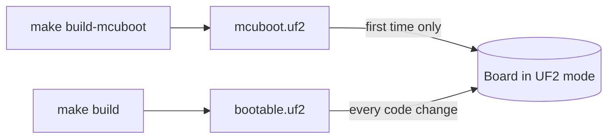

# Board List

The repo defines three PROVES Flight Controller boards under [`boards/bronco_space/`][boards]. All three use the RP2350A SoC on its Cortex-M33 core. Select one with `BOARD=` in `settings.ini`. See [Specifying Board Configuration][specifying-board-configuration].

## Boards

| Board | `BOARD=` string | Vendor (`board.yml`) | LoRa driver | Flash (`.yaml`, KB) |
| ----- | --------------- | -------------------- | ----------- | ------------------- |
| v5c | `proves_flight_control_board_v5c/rp2350a/m33` | Bronco Space | `CONFIG_LORA_SX127X` | 4096 |
| v5d | `proves_flight_control_board_v5d/rp2350a/m33` | Bronco Space | `CONFIG_LORA_SX127X` | 16384 |
| v5e (default) | `proves_flight_control_board_v5e/rp2350a/m33` | The Spacecraft Company LLC | `CONFIG_LORA_SX126X` | 16384 |

v5e is the default because [`settings.ini`][settings-ini] sets `BOARD=proves_flight_control_board_v5e/rp2350a/m33`.

### The shared v5 base

[`proves_flight_control_board_v5/`][v5-base] is not a board. It has no `board.yml`, so Zephyr cannot build it. It holds the shared files:

- `proves_flight_control_board_v5.dtsi` and `proves_flight_control_board_v5-pinctrl.dtsi`. Each variant `.dts` includes the dtsi.
- `Kconfig.defconfig`. Each variant `Kconfig.*` file sources it.

The base defines the flash partitions. MCUboot runs in swap-using-offset mode (`bootloader/sysbuild.conf`), so it swaps between two slots: `slot0_partition` and `slot1_partition`.

| Partition | Label | Offset | Use |
| --------- | ----- | ------ | --- |
| `boot_partition` | `mcuboot` | `0x000000` | MCUboot |
| `slot0_partition` | `current` | `0x100000` | Primary slot. The application runs from here (`zephyr,code-partition`). |
| `slot1_partition` | `golden` | `0x200000` | Secondary slot. `FlashWorker` writes uploaded images here and MCUboot swaps them in. After a swap it holds the previous image, so it is not a fixed golden image. |
| `slot2_partition` | `test` | `0x300000` | Defined but unused. |
| `storage_partition` | `storage_partition` | `0x400000` | Application file system |

## What differs between variants

Each variant `.dts` starts from the base and overrides a few nodes.

| | v5c | v5d | v5e |
| - | --- | --- | --- |
| Watchdog LED (`led0`) | GPIO 24 | GPIO 23 (base) | GPIO 23 (base) |
| LoRa radio | SX1276 (base) | SX1276 (base) | SX1262 (`E22-400M30S`) |
| LoRa DIO pins | GPIO 13, 12 | GPIO 14, 13 (base) | DIO1 on GPIO 14, BUSY on GPIO 13 |
| MCP23017 GPIO expander | `i2c1` (base) | `i2c1` (base) | `i2c0`, reset on GPIO 20 |
| S-band RX/TX enable | not defined | not defined | MCP23017 pins 4 and 7 |
| USB product string | `PROVES Flight Control Board v5c` | `PROVES Flight Control Board v5d` | `PROVES Flight Control Board v5e` |

v5d adds no overrides. It is the base as written.

v5e also sets these LoRa properties: reset on GPIO 6, TX enable on GPIO 21, RX enable on GPIO 22, a 1.8 V TCXO on DIO3, and `rx-boosted`. It removes the `rf2-io2` and `rf2-io3` inputs, because they use MCP23017 pins 4 and 7.

These files are the same for all three variants:

- `board.cmake`: registers the `openocd` runner (CMSIS-DAP by default, override with `RPI_PICO_DEBUG_ADAPTER`), the `jlink` runner (`RP2350_M33_0`), and the `uf2` runner (`RP2350`).
- `support/openocd.cfg`: defines the `set_adapter_speed_if_not_set` helper that `board.cmake` calls.

## Flashing

The Makefile makes these files at the repo root:

| File | Made by | Contents |
| ---- | ------- | -------- |
| `mcuboot.uf2` | `make build-mcuboot` | MCUboot bootloader, UF2 format |
| `mcuboot.elf` | `make build-mcuboot` | MCUboot bootloader, for SWD |
| `bootable.uf2` | `make build` | Signed application (`build-artifacts/zephyr.signed.bin`) as UF2, placed at `0x10100000` (`slot0_partition`) |
| `bootable.signed.hex` | `make build` | Signed application, for SWD |



!!! warning
    `make build-mcuboot` always builds MCUboot for v5e. [`tools/bin/build-with-proves`][build-with-proves] passes `-b proves_flight_control_board_v5e/rp2350a/m33` and does not read `settings.ini`.

### UF2 over USB

1. Put the board into UF2 bootloader mode. It mounts as a USB drive with a name like `RP2350`. If the board already runs F Prime, send `ReferenceDeployment.bootloaderTrigger.TRIGGER_BOOTLOADER` from the GDS. The [BootloaderTrigger][bootloader-trigger] component reboots the board into USB boot mode.

2. Find the drive path.

    ```sh
    # macOS
    ls -lah /Volumes

    # Linux
    findmnt
    ```

    On Windows, find the drive letter and the drive name, for example `/d/RP2350`.

3. First time only (new board, or a board coming back from CircuitPython): build and copy MCUboot.

    ```sh
    # In proves-core-reference
    make build-mcuboot
    cp mcuboot.uf2 [path-to-your-board]
    ```

4. Build the application, put the board back into UF2 mode, and copy the image.

    ```sh
    # In proves-core-reference
    make build
    cp bootable.uf2 [path-to-your-board]
    ```

Repeat step 4 after every code change.

!!! note
    Copy `bootable.uf2`, not `build-artifacts/zephyr.uf2`. MCUboot only boots images signed with its key. The build signs with `keys/proves.pem` (`CONFIG_MCUBOOT_SIGNATURE_KEY_FILE` in [`prj.conf`][prj-conf]), and `bootable.uf2` is made from the signed binary.

!!! warning
    If you flash a bootloader built on another computer, copy that computer's `keys/proves.pem` too. Otherwise the images you build will not boot.

### SWD with a debug probe

The Makefile can flash over SWD with OpenOCD and a CMSIS-DAP probe. The first run clones and builds the Raspberry Pi OpenOCD fork into `tools/openocd`.

```sh
# In proves-core-reference
make debug-install mcuboot.elf
make debug-install bootable.signed.hex
```

Flash MCUboot first. `bootable.signed.hex` only covers `slot0_partition`. The CI flash step uses the same order.

`make debug` starts OpenOCD against the probe without flashing.

<!-- Links -->
[specifying-board-configuration]: ./specifying-board-configuration.md
[boards]: https://github.com/Open-Source-Space-Foundation/proves-core-reference/blob/main/boards/bronco_space
[v5-base]: https://github.com/Open-Source-Space-Foundation/proves-core-reference/blob/main/boards/bronco_space/proves_flight_control_board_v5
[settings-ini]: https://github.com/Open-Source-Space-Foundation/proves-core-reference/blob/main/settings.ini
[build-with-proves]: https://github.com/Open-Source-Space-Foundation/proves-core-reference/blob/main/tools/bin/build-with-proves
[bootloader-trigger]: ../components/BootloaderTrigger/sdd.md
[prj-conf]: https://github.com/Open-Source-Space-Foundation/proves-core-reference/blob/main/prj.conf
