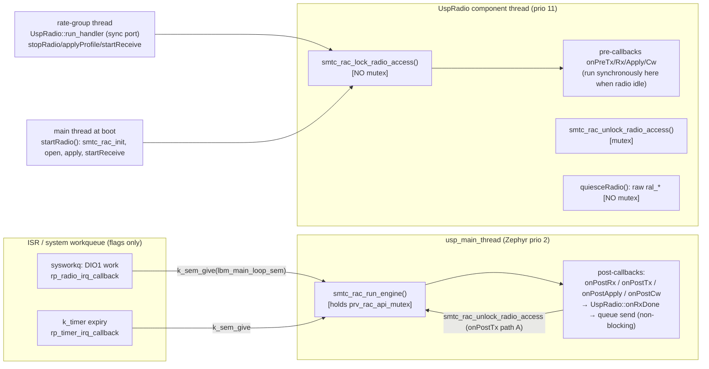

# Which thread runs the USP engine, and does the RAC mutex survive a single-queue UspRadio?

Research for [#585](https://github.com/Open-Source-Space-Foundation/proves-core-reference/issues/585) (map [#584](https://github.com/Open-Source-Space-Foundation/proves-core-reference/issues/584)).
Date: 2026-10-16.

## Answer

1. The `usp_main_thread` runs the RAC engine. This is a dedicated Zephyr thread at priority 2, created by `CONFIG_USP_MAIN_THREAD=y`. It calls `smtc_rac_run_engine()` in a loop, and every post-transaction hook callback into UspRadio (`onPostRx`, `onPostTx`, `onPostApply`, `onPostCw`) runs on that thread. **The pre-callbacks do not.** They usually run synchronously on the thread that called `smtc_rac_lock_radio_access()`.
2. **Yes, the mutex is still required.** Suppose UspRadio sent every call through its component queue. The USP thread would still enter the RAC on every loop iteration, and `onPostTx` would still call `smtc_rac_unlock_radio_access()` from that thread. That leaves two threads inside the RAC. The only way to drop the mutex is to remove the second thread: run the engine on the component thread with `CONFIG_USP_MAIN_THREAD=n`. That change also forces UspRadio's blocking waits to become a state machine.
3. **Yes, the engine holds the fork's `prv_rac_api_mutex` for the whole `rp_hook_callback` into UspRadio.** No UspRadio callback blocks. They only make SPI calls, `k_sem_give`, and a non-blocking F´ queue send. So that path has no deadlock cycle. A full queue there trips an assert, not a hang.
4. **New finding: the mutex is necessary but not enough.** `smtc_rac_lock_radio_access()` never takes the mutex, so `rp_task_enqueue()`, the arbiter, and the synchronous pre-callback with its SPI traffic all run unserialized against the engine pass. UspRadio uses this call for every TX, RX, apply, and CW. Upstream already has a fix that covers it, with no fork: `CONFIG_USP_THREADS_MUTEXES=y` plus `SMTC_SW_PLATFORM(...)` around each RAC call.
5. **Correction to the ticket's premise:** both OSSF forks are built on **v1.0.0**, not v1.2.1.

## Who touches the RAC today (PCR #439 head `1560dce`, fprime-zephyr `9e3bedc`)

| Thread | RAC entry points | Takes `prv_rac_api_mutex`? | Evidence |
|---|---|---|---|
| `usp_main_thread` | `smtc_rac_run_engine`, `smtc_rac_is_irq_flag_pending`, and through the post-callbacks, `smtc_rac_unlock_radio_access` | yes, across the whole engine pass, callbacks included | usp_zephyr@0bf3e20 `subsys/usp/zephyr_usp_thread.c:78-79,127,131`; usp@8a60e4a `smtc_rac.c:381-388`; fprime-zephyr@9e3bedc `RalSessionImpl.cpp:501` |
| UspRadio component thread | `lock_radio_access` (TX/RX/apply/CW), `unlock_radio_access`, `smtc_rac_get_rp`; plus raw `ral_*` in `quiesceRadio` | lock: **no**; unlock/get_rp: yes; quiesce: **no** | usp@8a60e4a `smtc_rac.c:495-524`, `473-493`, `399-407`; fprime-zephyr@9e3bedc `RalSessionImpl.cpp:670-673` |
| Rate-group thread | same set as the component thread, through `run_handler` → `stopRadio`/`applyProfile`/`startReceive` | as above | fprime-zephyr@9e3bedc `UspRadio.fpp:29` (`sync input port run`), `UspRadio.cpp:136-171` |
| Main thread (boot) | `smtc_rac_init`, `open_radio`, `get_radio`, `ral_reset/init`, apply, `startReceive` | partly | PCR@1560dce `ReferenceDeploymentTopology.cpp:131,137-138` (after `startTasks`); fprime-zephyr@9e3bedc `UspRadio.cpp:54-79`, `RalSessionImpl.cpp:97-124` |
| System workqueue | `rp_radio_irq_callback` (sets `radio_irq_flag`, timestamp, `k_sem_give`) | no (flags only, by design) | PCR@1560dce v5e defconfig `:43` (`EVENT_TRIGGER_GLOBAL_THREAD=y`); usp_zephyr@0bf3e20 `drivers/usp/sx126x/sx126x_board.c:65-66,111-118`, `modules/smtc_modem_hal/smtc_modem_hal.c:319-327`; usp@8a60e4a `radio_planner.c:1517-1523` |
| `k_timer` expiry (ISR) | `rp_timer_irq_callback` (sets `timer_irq_flag`, `k_sem_give`) | no (flags only) | usp_zephyr@0bf3e20 `smtc_modem_hal.c:214-226`; usp@8a60e4a `radio_planner.c:1525-1530` |

## Findings with citations

### F1. The engine thread

- With `CONFIG_USP_MAIN_THREAD=y`, usp_zephyr defines a static thread, `K_THREAD_DEFINE(lbm_main_thread_id, …, usp_main_thread, …, CONFIG_USP_MAIN_THREAD_PRIORITY, …)`. Its loop calls `smtc_rac_run_engine()` and then `smtc_rac_is_irq_flag_pending()`. When no IRQ flag is pending, it sleeps on `lbm_main_loop_sem`. Sources: usp_zephyr@0bf3e20 `subsys/usp/zephyr_usp_thread.c:78-79, 109-141`; `modules/smtc_modem_hal/smtc_modem_hal.c:157-167`. The code is the same at v1.2.1, where the engine call is on `:129` and the IRQ check on `:136`.
- The priority defaults to 2 (usp_zephyr@0bf3e20 `subsys/usp/Kconfig:52-56`), and PCR does not override it. fprime-zephyr passes the F´ priority straight to `k_thread_create` (fprime-zephyr@9e3bedc `Os/Task.cpp:36-48`), so UspRadio runs at Zephyr priority 11 (PCR@1560dce `RadioInstances_Usp.fppi:7-10`). The USP thread therefore preempts UspRadio, the rate groups, and main.
- PCR's v5e build sets `CONFIG_USP_MAIN_THREAD=y`. It does **not** set `CONFIG_USP_THREADS_MUTEXES`. Source: PCR@1560dce `boards/bronco_space/proves_flight_control_board_v5e/proves_flight_control_board_v5e_rp2350a_m33_defconfig:41-46`. That Kconfig defaults to `n` (usp_zephyr@0bf3e20 `subsys/usp/Kconfig:64-66`). As a result, the upstream thread-level `rac_api_mutex` around the engine pass is compiled out (`zephyr_usp_thread.c:111-113, 128-130`). The only lock in play is the fork's `prv_rac_api_mutex`, taken inside `smtc_rac_run_engine`.
- `rp_callback` calls `rp_hook_callback`, which calls `smtc_rac_rp_callback`, which calls the user's `callback_post_radio_transaction`. Sources: usp@8a60e4a `radio_planner.c:501, 575, 1532-1547`; `smtc_rac.c:605-657`, with the user callback at `:657`. The same calls appear at v1.2.1 on `radio_planner.c:1581-1594` and `smtc_rac.c:748`.

### F2. Pre-callbacks run on the caller's thread, not the USP thread

- Here is the call chain, from usp@8a60e4a:
  1. `smtc_rac_lock_radio_access` calls `rp_task_enqueue` (`smtc_rac.c:516`).
  2. When `radio_irq_flag == false`, the enqueue calls `rp_task_arbiter` inline (`radio_planner.c:384-387`).
  3. For an ASAP task while the radio is idle, the arbiter calls `rp_task_launch_current` (`:789-800`).
  4. That calls `launch_task_callbacks` (`:1078`), which is `smtc_rac_lock_radio_access_callback`.
  5. That calls the user's `callback_pre_radio_transaction` (`smtc_rac.c:581-589`).
- **Inference:** `onPreTx`, `onPreRx`, `onPreApply`, and `onPreCw` normally run on whichever thread called `transmitPacket`, `startReceive`, `applyProfile`, or `startCw`. They move to the USP thread only when the enqueue lands while `radio_irq_flag` is set. The header comment in fprime-zephyr@9e3bedc `RalSessionImpl.cpp:7-12` says "ALL ral_* calls must run on the USP thread". The code doesn't do that.

### F3. The mutex is needed even if UspRadio funnels everything through one queue

Assume every UspRadio RAC call moves onto the component queue. That covers `run_handler`, which today runs on the rate-group thread, and `startRadio`, which runs on main. Even then, a second thread still enters the RAC:

- The USP thread runs `smtc_rac_run_engine` and `smtc_rac_is_irq_flag_pending` on every loop iteration (usp_zephyr@0bf3e20 `zephyr_usp_thread.c:127,131`).
- On the USP thread, `onPostTx` path A calls `smtc_rac_unlock_radio_access`, which enters `rp_task_abort` (fprime-zephyr@9e3bedc `RalSessionImpl.cpp:499-501`; usp@8a60e4a `smtc_rac.c:473-493`).
- The workqueue and ISR writers only set flags (`radio_planner.c:1517-1530`). Upstream treats them as safe without the lock, as on bare metal.

The planner state in `radio_planner_t` is therefore shared between at least two preemptive threads, and the engine pass must be serialized against component-thread API calls. The fork's commit gives the observed failure as torn `rp_task_t` on RP2350 (usp_zephyr@0bf3e20 `smtc_modem_hal.c:179-192`). Upstream's own doc says the same: a preemptive USP thread requires mutex protection (usp_zephyr@v1.2.1 `doc/THREAD_MANAGEMENT.md:16-29, 115-153`).

The only configuration that removes the need is the upstream "single thread mode" (`CONFIG_USP_MAIN_THREAD=n`, `THREAD_MANAGEMENT.md:11-14, 33-68`). In that mode the application thread runs the engine itself. **Inference:** for UspRadio this would mean:

- (a) Drive `smtc_rac_run_engine` from the component thread, woken by an internal message posted from the radio IRQ or timer path.
- (b) Remove every blocking wait on that thread: `k_sem_take` in `transmitPacket` (`RalSessionImpl.cpp:545`), `applyProfile` (`:192`), `startCw` (`:614`), and `stopRadio` (`:712`), plus the `k_sleep` polls (`:398-402, :556-560`). Those semaphores are given by post-callbacks that the engine would now run on the same thread, so a blocking wait would self-deadlock.
- (c) Replace `zephyr_usp_initialization_wait()` (`RalSessionImpl.cpp:99`). It is built only with `USP_MAIN_THREAD` (usp_zephyr@0bf3e20 `subsys/usp/CMakeLists.txt:9-14`; `smtc_sw_platform_helper.h:92-101`).

### F4. The engine holds the mutex across `rp_hook_callback`, and the callbacks don't block

- `smtc_rac_run_engine` wraps `rp_callback` in `smtc_modem_hal_protect_api_call` and `unprotect` (usp@8a60e4a `smtc_rac.c:381-388`; v1.2.1 `:402-406`). The fork maps those calls to `k_mutex_lock(&prv_rac_api_mutex, K_FOREVER)` (usp_zephyr@0bf3e20 `smtc_modem_hal.c:193-205`). Upstream's versions are empty: v1.2.1 `:184-192`, v1.0.0 `:179-187`. **Every hook callback into UspRadio therefore runs with the mutex held.**
- Re-entry happens on the same thread. `smtc_rac_rp_callback` calls `smtc_rac_get_rp()` and `smtc_rac_get_context()` (`smtc_rac.c:609, 613`), and `onPostTx` and `onPreApply` call `smtc_rac_unlock_radio_access`. Zephyr `k_mutex` is recursive for its owner, so this works. The fork comment relies on that (`smtc_modem_hal.c:187-190`).
- What each callback does (fprime-zephyr@9e3bedc `RalSessionImpl.cpp`):

  | Callback | Lines | Work |
  |---|---|---|
  | `onPostRx` | `322-376` | SPI `ral_*` calls; `m_rxDone`; `ral_set_rx`; `k_sem_give` |
  | `onPostTx` | `476-521` | SPI calls; unlock; `k_sem_give` |
  | `onPostApply` | `164-170` | `k_sem_give` |
  | `onPostCw` | `592-596` | `k_sem_give` |

  `m_rxDone` is `UspRadio::onRxDone` (`UspRadio.cpp:104-130`). It does a ring write and calls `deferredRxDone_internalInterfaceInvoke`. The internal port declares no queue-full policy (`UspRadio.fpp:33`), so the FPP default `assert` applies. Generated code from a PCR build of fprime-zephyr `c81485f`, a different sha with the same port declaration, sends with `Os::Queue::NONBLOCKING` and then calls `FW_ASSERT(qStatus == OP_OK)` (`build-fprime-automatic-zephyr/fprime-zephyr/Drv/UspRadio/UspRadioComponentAc.cpp:1400-1406`). That build is corroboration only, not the pinned sha.
- **Conclusion (inference from the above):**
  - No UspRadio callback waits on a semaphore, mutex, or queue, so the engine never waits on the component thread while holding the mutex.
  - The component thread's blocking waits (`k_sem_take`, `k_sleep` polls) all happen after the RAC call has returned and released the mutex.
  - No lock-order cycle exists, and `k_mutex` has priority inheritance.
  - The residual risks are a queue-full **assert** on the USP thread when the RX ring is deeper than the free queue slots, and SPI BUSY-poll time spent while holding the mutex. Neither is a deadlock.

### F5. The fork's mutex leaves the hot path unprotected

- `smtc_rac_lock_radio_access` contains no protect call. Its only lock is the brief one inside the `smtc_rac_get_rp()` argument evaluation (usp@8a60e4a `smtc_rac.c:495-524`; v1.2.1 `:514-543`; upstream v1.0.0 has the same shape at `:495`).
- In that window, three things happen with no lock held:
  - writes to `smtc_rac_context[]` and `smtc_rac_callbacks[]` (`:501-502`)
  - all of `rp_task_enqueue`, which writes `rp->tasks[hook_id]` and runs the arbiter (`radio_planner.c:359-387`)
  - the synchronous pre-callback with its SPI traffic (F2)
- The fork comment claims the RAC "wraps every public entry point" (usp_zephyr@0bf3e20 `smtc_modem_hal.c:179-182`). That is not true for this entry point.
- **Inference:** a DIO1 or timer wake can preempt the component thread in the middle of `rp_task_enqueue`, because the USP thread outranks it (F1). The engine pass can then run against a half-written task. That is the same race class the fork commit describes.
- UspRadio adds more unlocked access:
  - It reads `rp->tasks[m_radio_id].state` with no lock (`RalSessionImpl.cpp:396-403, 554-560, 697-698, 716`).
  - It issues raw `ral_set_standby` and `ral_clear_irq_status` from `quiesceRadio` (`:670-673`). The comment at `:664-668` accepts that this can interleave with a lazy-sleep `ral_set_sleep` on the USP thread.
- **Upstream already covers this without a fork.** The upstream `SMTC_SW_PLATFORM(call)` wrapper takes `rac_api_mutex` around the whole call, which includes `lock_radio_access`'s enqueue and inline pre-callback (usp_zephyr@0bf3e20 `include/zephyr/usp/smtc_sw_platform_helper.h:73-87`). With `CONFIG_USP_THREADS_MUTEXES=y`, the USP thread holds the same mutex across `smtc_modem_run_engine`/`smtc_rac_run_engine` (`zephyr_usp_thread.c:111-130`). The mutex is defined at `subsys/usp/smtc_sw_platform_helper.c:84-88`.
- **Inference:** enabling that Kconfig and wrapping RalSessionImpl's RAC calls (and `quiesceRadio`) in `SMTC_SW_PLATFORM`/`SMTC_SW_PLATFORM_VOID` would serialize everything the fork's HAL mutex misses, and would make usp_zephyr PR #5 (`bbdd729`) unnecessary. Re-entry from callbacks happens on the owning thread, so the recursive `k_mutex` handles it. This needs a bench check before #584 relies on it.

### F6. Both fork bases are v1.0.0

- `git merge-base 0bf3e20 v1.2.1` resolves to `bfacd43`, which is tag `v1.0.0`. `git diff --shortstat v1.0.0 0bf3e20` touches 8 files, against 341 for v1.2.1. The usp fork `8a60e4a` is `v1.0.0` plus 3 files, against 781 for v1.2.1.
- The ticket's "upstream v1.2.1" is therefore not what PCR runs. The PCR pins are `west.yml:93-104` @1560dce.
- Every finding above was checked at both the fork sha and v1.2.1 where the code exists in both. The engine, lock, enqueue, and callback shapes are unchanged between them.

## Open / not checked

- Upstream does not document the k_timer expiry context in its source. ISR context comes from Zephyr's `k_timer` semantics.
- Nobody has bench-tested `CONFIG_USP_THREADS_MUTEXES=y` with `SMTC_SW_PLATFORM` wrappers (F5).
- Whether a single-thread (`USP_MAIN_THREAD=n`) UspRadio is worth its rewrite cost is a design question for #584, not a research one.
