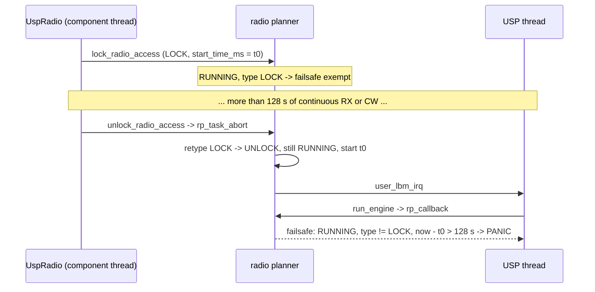

# Can `rp_disable_failsafe()` replace the usp fork's UNLOCK failsafe exemption?

Research for [#586](https://github.com/Open-Source-Space-Foundation/proves-core-reference/issues/586) (map [#584](https://github.com/Open-Source-Space-Foundation/proves-core-reference/issues/584)).

## Answer

Yes. Call `rp_disable_failsafe(smtc_rac_get_rp(), true)` once in `RalSessionImpl::init()`, after `smtc_rac_init()`. It suppresses every panic the fork's exemption suppresses.

- In a RAC-only build, nothing ever sets the flag back to false. The only reset is `rp_init()`, and that runs once, inside `smtc_rac_init()`.
- `smtc_rac_fsk.c:374` is in the RAC **CW** launch path (`smtc_rac_submit_radio_transaction`). UspRadio never calls that path, so a GFSK profile switch never reaches it.
- In UspRadio's usage, this loses no real protection. UspRadio only creates LOCK tasks, and upstream already exempts LOCK tasks from the failsafe. The only panic the failsafe can still raise is the false positive this fix removes.
- The usp fork also carries a second commit, lazy-sleep hysteresis. You can delete the fork only if you also drop lazy-sleep.

Source pins: `usp` tags v1.0.0 and v1.2.1 (Lora-net); the OSSF usp fork at `8a60e4a`; `usp_zephyr` fork at `0bf3e20` (the PCR #439 pin); `fprime-zephyr` at `9e3bedc`. Statements marked **[inference]** are reasoned from the code and were not tested on hardware.

## 1. The failsafe

```c
// usp v1.0.0 smtc_rac_lib/radio_planner/src/radio_planner.c:447-453  (v1.2.1: 471-477, identical)
if( ( rp->tasks[rp->radio_task_id].state == RP_TASK_STATE_RUNNING ) &&
    ( rp->tasks[rp->radio_task_id].type != RP_TASK_TYPE_LOCK_RADIO_ACCESS ) &&
    ( rp->disable_failsafe != RP_DISABLE_FAILSAFE_KEY ) &&
    ( ( int32_t ) ( rp->tasks[rp->radio_task_id].start_time_ms + 128000 - smtc_modem_hal_get_time_in_ms( ) ) < 0 ) )
{
    SMTC_MODEM_HAL_PANIC( "RP_FAILSAFE - #%d\n", rp->radio_task_id );
}
```

- The check is the first statement of `rp_callback()` (v1.0.0 `radio_planner.c:445`). It runs on every `smtc_rac_run_engine()` call (v1.0.0 `smtc_rac.c:381-385`), which the USP thread calls in its main loop (`usp_zephyr@0bf3e20 subsys/usp/zephyr_usp_thread.c:127`).
- The conditions are joined by AND. If `disable_failsafe == RP_DISABLE_FAILSAFE_KEY` (`0xF00D4BEE`, `radio_planner_types.h:114`), the check never panics, whatever the task type or age.
- v1.2.1 did not change this check. It still exempts only LOCK. The UNLOCK gap exists in both tags.

## 2. Every write to `rp->disable_failsafe`

| Site (v1.0.0 / v1.2.1) | Value | Reached by UspRadio? |
|---|---|---|
| `radio_planner.c:238` / `:248`, in `rp_init()` | `0` (armed) | Once, from `smtc_rac_init()` (`smtc_rac.c:341` / `:354`). UspRadio calls `smtc_rac_init()` once, at `RalSessionImpl.cpp:105`. The USP thread does not call it (`zephyr_usp_thread.c:103` is commented out). |
| `radio_planner.c:563-572` / `:613-622`, `rp_disable_failsafe()` | set or clear | Only through the callers below. |
| `smtc_rac_fsk.c:374` (both tags) | `true` | **No.** It sits inside `if( rac_config->cw_context.cw_enabled )` (`:372`), in the FSK launch callback that `smtc_rac_fsk()` (`:158`) registers. That code runs only from `smtc_rac_submit_radio_transaction()` (`smtc_rac.c:529` / `:569`). |
| `smtc_rac_lora.c:488` / `:516` | `true` | **No.** Same pattern: the LoRa CW branch (`:486` / `:514`) of the submit path. |
| `protocols/lbm_lib/smtc_modem_core/smtc_modem.c:1155` and `:1164` | `true`, then `false` | **No. This file is not compiled.** It is built only when `CONFIG_USP_LORA_BASICS_MODEM` is set (`usp_zephyr modules/usp/common.cmake:11-12` → `modules/lora_basics_modem/common.cmake:102`). That option defaults to `n` (`subsys/usp/Kconfig:32-34`), and PR #439 never sets it. |
| `smtc_modem_test.c:198, 229` (false) and `:497, 567, 630` (true); v1.2.1 is +2 | both | **No.** This file is in the same LBM-only source list (`common.cmake:103`). |

UspRadio never calls `smtc_rac_submit_radio_transaction` (no match in `fprime-zephyr@9e3bedc`). All of its radio work runs inside a RAC lock, through raw RAL calls:

- `applyGfsk`, `applyLoRa`, and `onPreTx` use raw RAL.
- `onPreCw` also uses raw RAL, so UspRadio's own CW never goes through the RAC CW path at `smtc_rac_fsk.c:374`.

**Conclusion:** the only code path that writes `false` in this build is `rp_init()`. A GFSK profile switch does not re-arm the failsafe.

## 3. What UspRadio enqueues, and which patterns trip the failsafe

UspRadio has one hook (`m_radio_id`, from `smtc_rac_open_radio`). It enqueues only one task type: `RP_TASK_TYPE_LOCK_RADIO_ACCESS` (`smtc_rac_lock_radio_access`, v1.0.0 `smtc_rac.c:495-523`). The task gets a second type only through this retype:

```c
// v1.0.0 radio_planner.c:397-404 (v1.2.1: 412-419), inside rp_task_abort() for a RUNNING task
if( rp->tasks[hook_id].type == RP_TASK_TYPE_LOCK_RADIO_ACCESS )
    rp->tasks[hook_id].type = RP_TASK_TYPE_UNLOCK_RADIO_ACCESS;
rp->radio_irq_flag = true;            // fake IRQ
smtc_modem_hal_user_lbm_irq( );       // wakes USP thread -> rp_callback()
```

`smtc_rac_unlock_radio_access()` is just `rp_task_abort()` (v1.0.0 `smtc_rac.c:525-528`, `:478`). The retyped task stays in `RUNNING` and keeps its `start_time_ms`. Once a task is running, the planner does not refresh that field: `rp_task_update_time` changes it only for ASAP tasks (`radio_planner.c:606-630`). On the next engine pass, the failsafe check runs before the fake IRQ is processed.



How long each UspRadio lock is held (`fprime-zephyr@9e3bedc`):

| Lock pattern | Released by | Hold time | Trips the failsafe without a fix? |
|---|---|---|---|
| `applyProfile` (`RalSessionImpl.cpp:172-198`) | `onPreApply` unlocks inside the pre-callback (`:161`) | Milliseconds | No |
| `transmitPacket` (`:523-560`) | `onPostTx` on TX_DONE (`:501`). On a 10 s timeout, the caller aborts (`:553`). | ≤ 10 s plus airtime | No |
| `startReceive` continuous RX (`:387-424`; `onPreRx` arms `RAL_RX_TIMEOUT_CONTINUOUS_MODE` at `:317`; `onPostRx` re-arms and keeps the lock, `:366`) | `stopRadio()` (`:675`) | **Unbounded.** This is the normal idle state. | **Yes**, on the first `stopRadio()` after more than 128 s of RX. Callers in `UspRadio.cpp`: TX frame `:294`, profile revert in `run_handler` `:159`, `deferredTransmitCmd` `:424`, set TX/RX profile `:445` / `:474` / `:492`, CW entry `:516`, and the TX error path `:340`. |
| `startCw` (`:598-616`) | `stopRadio()` after `k_sleep(seconds)` (`UspRadio.cpp:516-537`) | `seconds` (U16, no range check in `CONTINUOUS_WAVE_cmdHandler`, `:556-559`) | **Yes**, if `seconds` > 128. **[inference]** The code comment says ≤10 s, but nothing enforces it. |
| `stopRadio()` on an idle hook | `rp_task_abort` returns early for state > ABORTED (v1.0.0 `radio_planner.c:382-385`) | No retype | No |

The failsafe can panic only on UNLOCK. Upstream exempts LOCK, and UspRadio never creates any other task type. The panic happens at the moment a lock older than 128 s is released. This is the "5× TRANSMIT past the 128 s window" drill in #584(c), and the bug described in PCR commit `f5a0e3b5` ("any lock held > 128 s (continuous RX under raw RAC) panicked the board on the first engine pass after the next radio command").

**Does a global disable cover all of them?** Yes. The disable condition is part of the AND, so it suppresses the UNLOCK panic for RX-then-stop, CW-then-stop, and any future lock pattern. The fork's change (`9d0dccfd6c`, `radio_planner.c` `+ type != RP_TASK_TYPE_UNLOCK_RADIO_ACCESS`) covers exactly the same cases, because UNLOCK is the only type left that can trip the check.

## 4. What protection a global disable loses

- **Compared with the fork:** effectively none. With the fork, a UspRadio task could panic only if it were neither LOCK nor UNLOCK, and UspRadio creates no such task. **[inference]** The fork also never catches an UNLOCK that wedges in RUNNING, so a global disable gives up nothing there either. The UspRadio-side watchdogs still catch that case: `stopRadio`'s 1 s deadline (`RalSessionImpl.cpp:712-726`) and the 10 s TX wait.
- **Compared with stock upstream:** a dead-task detector for RAC-submitted transactions: `smtc_rac_submit_radio_transaction` TX, RX, CAD, LR-FHSS, and FLRC tasks stuck RUNNING for more than 128 s. UspRadio does not use those. If someone later adds a submit-path user, or enables `CONFIG_USP_LORA_BASICS_MODEM` (LBM re-arms the failsafe at `smtc_modem.c:1164`), this tradeoff needs another look.
- **The torn-state symptom.** Commit `f5a0e3b5` records an `RP_FAILSAFE` with `type != LOCK` on a lock task. Unserialized RAC calls had torn the task slots. With the failsafe disabled, that symptom would no longer reboot the board. The actual fix is the RAC API mutex in usp_zephyr (patch 0008, usp_zephyr PR #5), which is a separate change. **[inference]** The panic was a side effect of the corruption, not a designed check for it.

## 5. Placement and caveats

- Call it **after** `smtc_rac_init()`, because `rp_init()` clears the flag. Call it **before** the first `smtc_rac_lock_radio_access`. In `RalSessionImpl::init()` (`RalSessionImpl.cpp:97-131`), right after line 105, `rp` is available through `smtc_rac_get_rp()`, the same accessor `startReceive` uses at `:396`.
- **[inference]** `rp_disable_failsafe` is one aligned 32-bit store with no `smtc_modem_hal_protect_api_call()`. If it runs before any task is enqueued, it cannot race the engine. Wrapping it in protect/unprotect for symmetry is harmless.
- **Lazy-sleep goes with the fork.** OSSF usp `8a60e4a` is v1.0.0 plus two merges, not one: PR #1 is the UNLOCK exemption (`9d0dccfd6c`), and PR #2 is lazy-sleep hysteresis (`3ee6cd2574`, measured at 1.15x GFSK downlink throughput). Dropping the fork also drops lazy-sleep. #584 lists lazy-sleep as out of scope, which suggests that is acceptable. The `quiesceRadio()` comment in fprime-zephyr (`RalSessionImpl.cpp:643-676`) refers to the lazy-sleep path, so it becomes stale but stays correct.
- **v1.2.1:** the failsafe and every writer are unchanged; only line numbers moved. The same one-line init call works on either tag.
